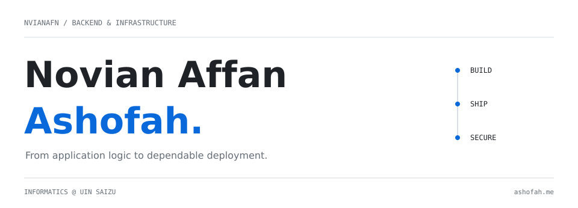

<picture>
  <source media="(prefers-color-scheme: dark)" srcset="./assets/profile-dark.svg">
  <source media="(prefers-color-scheme: light)" srcset="./assets/profile-light.svg">
  
</picture>

  <a href="https://ashofah.me">Portfolio ↗</a>
  &nbsp; / &nbsp;
  <a href="mailto:affan.ashofah@gmail.com">Email ↗</a>
  &nbsp; / &nbsp;
  <a href="https://github.com/Nvianafn?tab=repositories">Repositories ↗</a>

 

I'm **Affan**, an Informatics student at UIN Saizu Purwokerto.
I build backend systems, manage Linux deployments, and explore application security.

### 01 / Build · Ship · Secure

| Build | Ship | Secure |
| :--- | :--- | :--- |
| RESTful APIs & relational data | Linux hosting & CI/CD | Access control & server hardening |
| `Laravel` `Node.js` `MySQL` | `Nginx` `PM2` `GitHub Actions` | `RBAC` `SSL/TLS` `Burp Suite` |

 

### 02 / Selected work

**[YASU Project ↗](https://yasu-project.com)**  
A full-stack platform with a Next.js frontend and a Node.js API.  
`Next.js` `Node.js` `REST API` · [Live website ↗](https://yasu-project.com)

**[PMII Rayon Saintek ↗](https://github.com/Nvianafn/pmii-rayon-saintek-laravel)**  
A publishing platform with article management and role-based administration.  
`Laravel` `MySQL` · [Live website ↗](https://rayonsaintek.com)

**[Personal portfolio ↗](https://github.com/Nvianafn/ashofah-portfolio)**  
My space for projects, experiments, and an interactive terminal.  
[Explore ashofah.me ↗](https://ashofah.me)

 

  
03 / Beyond the core stack

   

  **Web:** JavaScript, TypeScript, Next.js, Tailwind CSS, Bootstrap  
  **Infrastructure:** Docker (basic), Cloudflare R2, Cloudflare Tunnel, Azure Container Apps  
  **Tools:** Git, Bash, Postman, VS Code, Figma

 

---

Curious about how systems work. Careful about how they run.
